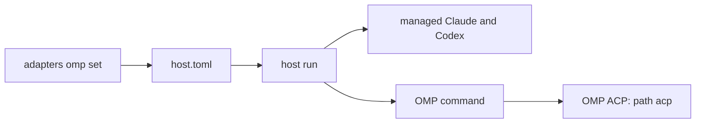

# OMP adapter design

**Date:** 2026-10-23

**Status:** Proposed

**Goal:** Let a paired Hennery host run a locally installed OMP ACP agent as a persistent first-class adapter.

**Scope:** This design adds an external OMP adapter. It does not bundle OMP, Bun, or provider credentials.

## Evidence

OMP documents `omp acp` as its ACP command. It uses standard input and standard output for ACP JSON-RPC. See <https://omp.sh/docs/acp>.

The official package is `@oh-my-pi/pi-coding-agent`. Version `18.12.6` needs Bun `>=1.3.14`. See <https://registry.npmjs.org/@oh-my-pi%2fpi-coding-agent/latest>.

Hennery's managed adapter set starts each adapter with its pinned Node runtime. See `crates/hennery-host/src/runtime/agents.rs`.

The installed OMP command reports `omp/18.12.6` on 2026-10-23.

## Root cause

**Hypothesis:** The Node-only managed set cannot run the official OMP package.

**Evidence:** The package needs Bun. The managed set starts Node.

**Alternative rejected:** A generic `--agent 'omp=omp acp'` command works. It is not persistent and runs as an unclassified generic agent.

## Decisions

1. Hennery supports OMP as an external program.
2. Hennery does not install OMP, Bun, or provider credentials.
3. An operator supplies an absolute program path.
4. The host starts that program as `<path> acp`.
5. The path persists in `host.toml`.
6. OMP receives `Profile::Omp` from this configuration. A `--agent` command named `omp` remains `Profile::Generic`.
7. OMP reports `McpIsolation::None`. The host refuses MCP servers unless the collector waives isolation.
8. Hennery does not claim strict OMP isolation. The ACP guide says OMP does not load its local MCP configuration in ACP mode. This fact alone does not prove the installed binary.
9. Hennery does not inspect OMP provider credentials. The operator configures them with OMP.
10. Hennery does not delete OMP transcript files in this change. Existing session close still uses ACP.

## Command contract

Add these commands under `hennery host adapters`:

```text
hennery host adapters omp set /absolute/path/to/omp
hennery host adapters omp remove
```

`set` must reject a non-absolute path. It must reject `.` and `..` path parts. It must reject a non-regular file and a file without run permission.

`remove` must succeed if no OMP path exists. It must remove only the OMP configuration.

Neither command downloads a managed adapter set. Neither command changes the Claude or Codex configuration.

## Persistent configuration

Store the program path in the paired host configuration.

```toml
[agents.omp]
executable = "/absolute/path/to/omp"
```

The configuration reader must preserve all unrelated `host.toml` fields. A malformed OMP value must not start an OMP process. The host must log one diagnostic and continue with available adapters.

The service already starts `hennery host run` from the paired host data directory. It must load this configuration without extra service arguments.

## Startup data flow



The default-agent path must merge the configured OMP command with managed agents. OMP must remain available when no managed set exists or its Node runtime is unavailable.

The configured OMP command has `program = <path>`, `args = ["acp"]`, and no added environment variables. The host keeps the existing environment scrub and process-group supervision.

## Profile and MCP behavior

Add `Profile::Omp` and the matching runtime profile value. Its session metadata is empty. Its isolation is `none`.

The host must pass collector MCP servers to OMP only after an explicit isolation waiver. This rule matches Codex and generic agents. It prevents an unsupported isolation claim.

The profile must come from the persisted OMP configuration, not from an agent name. A user-supplied `--agent omp=…` remains generic.

## Doctor behavior

When OMP is configured, doctor must run two checks in the host service environment:

1. Run `<path> --version`. The command must return success and identify itself as OMP.
2. Start `<path> acp` and do ACP `initialize` through the existing adapter-start check.

Doctor must state that it cannot check OMP login state. It must not read credentials or invoke interactive login.

Doctor must report a missing path, a file without run permission, a failed command, or a non-OMP command. It must give a direct repair command.

## Documentation

Document the OMP setup in the host quickstart:

1. Install OMP with its official installer or another supported local method.
2. Confirm `omp --version`.
3. Configure provider credentials through `omp` and `/login`.
4. Give Hennery the OMP path.

   Bash:

   ```sh
   hennery host adapters omp set "$(command -v omp)"
   ```

   Fish:

   ```fish
   hennery host adapters omp set (command -v omp)
   ```

5. Run `hennery doctor`.

The documentation must explain that OMP is external and no version is pinned by Hennery. It must state that MCP delivery needs the existing explicit isolation waiver.

## Needs and checks

| ID | Need | Check |
|---|---|---|
| R1 | The command stores only an absolute OMP path. | Unit test for accepted and refused paths. |
| R2 | Removing OMP preserves pairing and other adapter configuration. | Host configuration integration test. |
| R3 | Default host startup starts configured OMP with `acp`. | CLI test with an ACP fixture file with run permission. |
| R4 | OMP starts without a managed set or Node runtime. | CLI test with no set on disk. |
| R5 | A manual `--agent` value named OMP remains generic. | Profile unit test. |
| R6 | OMP reports no MCP isolation and rejects unwaived MCP servers. | Session MCP test. |
| R7 | Doctor probes the configured OMP path and ACP initialization. | Doctor test with success and failure fixtures. |
| R8 | Service startup reads the persisted OMP configuration. | Service command test and host startup test. |
| R9 | README states installation, authentication, setup, version, and MCP limits. | README command-block check. |

## Out of scope

- A Bun runtime in the managed adapter set.
- An OMP package pin, lockfile, package signature, or release update workflow.
- Automatic OMP installation or update.
- Provider login checks or credential copying.
- Claims of strict MCP isolation.
- OMP transcript deletion or OMP-specific session discovery.

## Rejected alternatives

| Alternative | Decision | Reason |
|---|---|---|
| Bundle OMP and Bun | Rejected | This changes Hennery's distribution trust boundary and CI. |
| Document `--agent 'omp=omp acp'` only | Rejected | The command is transient and generic. |
| Mark all OMP ACP processes as strict | Rejected | A configured external path has no provenance proof. |
| Use third-party `omp-acp` | Rejected | OMP provides `omp acp` itself. |

## Verification commands

Run these checks before a pull request:

```sh
cargo test -p hennery-host runtime::agents
cargo test -p hennery --test cli
cargo test -p hennery-testkit --test session_mcp
cargo test -p hennery -- doctor
cargo fmt --check
cargo clippy --workspace --all-targets -- -D warnings
```

Run the repository pre-flight command on the final commit. Use the exact repository command that CI names.
